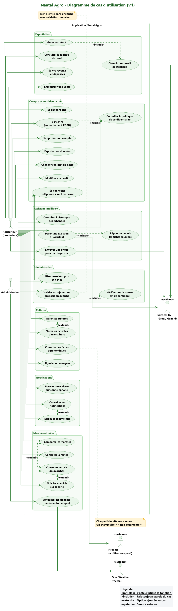
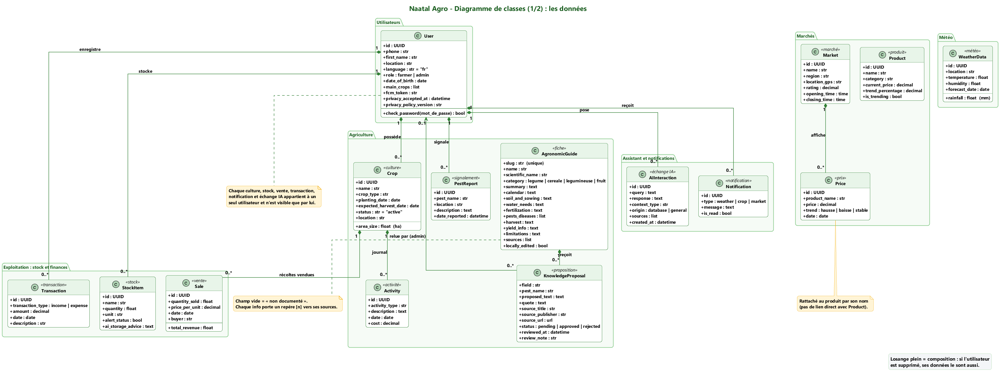
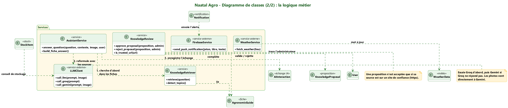
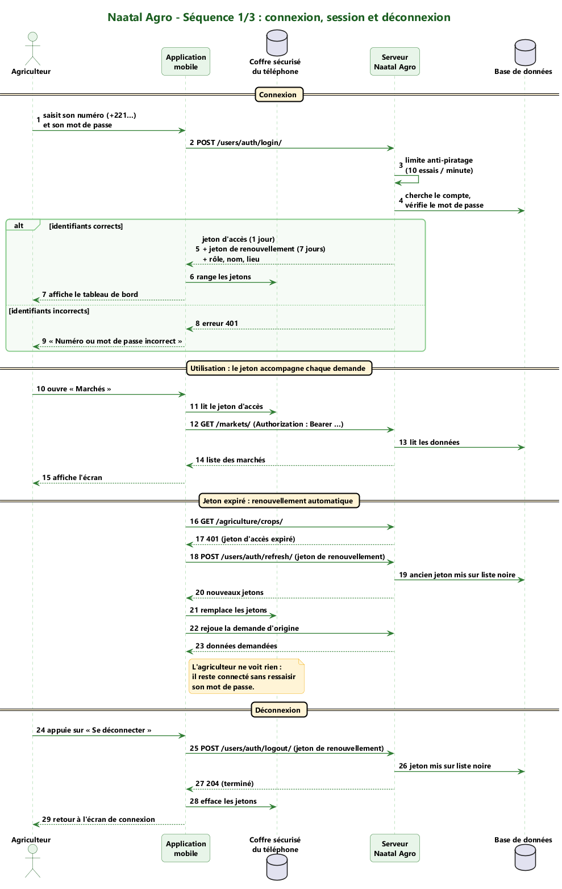
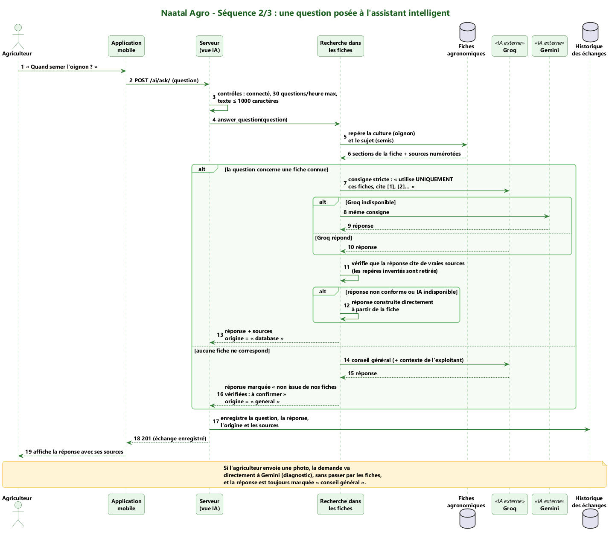
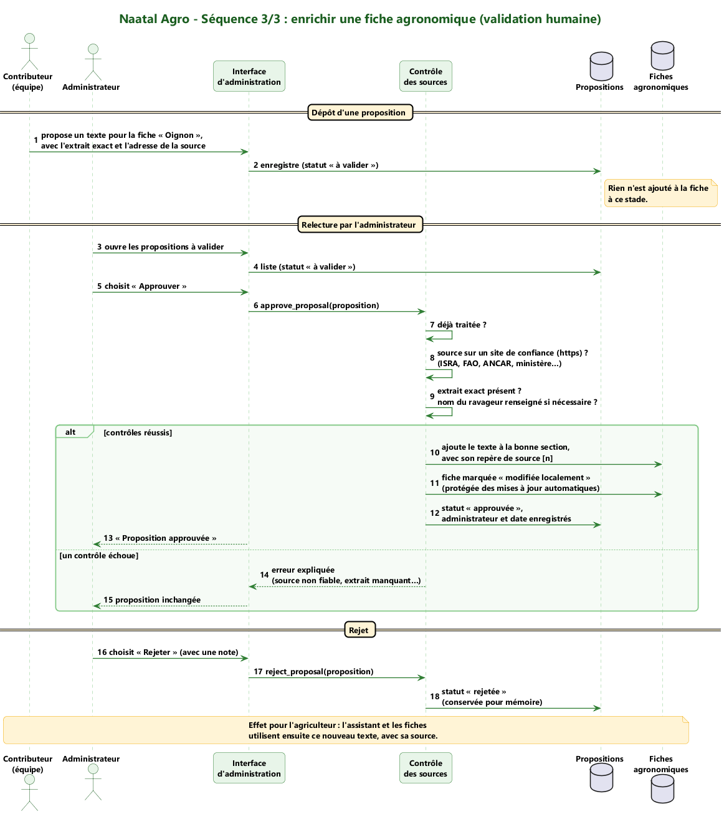

# CHAPITRE II : CONTEXTE DE L'ÉTUDE

## Section 1 : Contexte général

### Sous-section 1 : L'importance du secteur agricole dans l'économie sénégalaise

L'agriculture sénégalaise combine une agriculture pluviale, dominante dans le Bassin arachidier et en Casamance (mil, sorgho, maïs, arachide, niébé), une agriculture irriguée dans la vallée du fleuve Sénégal (riz, tomate industrielle, oignon) et un maraîchage périurbain très actif dans la zone des Niayes, bande littorale entre Dakar et Saint-Louis (oignon, pomme de terre, chou, carotte, piment). Cette diversité se retrouve dans les fiches agronomiques et dans le calendrier agricole de Naatal Agro, qui couvrent des céréales, des légumineuses, des légumes et des fruits répartis par zone agro-écologique.

Les chiffres macroéconomiques de référence sont rappelés dans l'introduction : le secteur contribue pour 16 à 17 % au produit intérieur brut et occupe environ un cinquième de la population active selon les sources les plus prudentes, avec des écarts selon les méthodes de calcul. [À COMPLÉTER : un tableau de chiffres clés (production céréalière, superficies, nombre d'exploitations familiales) tiré des publications du ministère de l'Agriculture, de l'ANSD et de la FAO, avec année et source pour chaque ligne.] Les politiques publiques font de la modernisation de l'agriculture une priorité ; la numérisation des services au producteur en est l'un des leviers. [À COMPLÉTER : citer le document de politique agricole précis et sa période.]

### Sous-section 2 : Les défis majeurs : information, marchés, climat et inclusion

Cinq défis structurent le besoin auquel répond le projet :

1. **L'accès à une information agronomique fiable et à jour.** Les itinéraires techniques existent dans des documents de recherche ou de vulgarisation, souvent anciens. Plusieurs de nos sources datent de 2005 à 2017 ; nous devons donc signaler que les variétés et les doses sont à confirmer auprès d'un conseiller.
2. **La connaissance des prix.** Sans information sur les prix pratiqués sur les différents marchés, le producteur négocie en position de faiblesse et ne sait pas où vendre.
3. **Les aléas climatiques.** Le calendrier cultural dépend de pluies irrégulières ; une prévision locale peut décider de la date d'un semis ou d'un traitement.
4. **Les risques sanitaires des cultures.** Le choix d'un traitement (produit, dose, moment) est une décision à risque pour la récolte, la santé et l'environnement.
5. **L'inclusion numérique.** Une partie importante des producteurs est peu lettrée et parle d'abord une langue nationale. Une application purement textuelle les exclut.

À ces défis s'ajoute une contrainte technique : une connexion souvent intermittente en zone rurale.

## Section 2 : Contexte spécifique (le projet Naatal Agro)

### Sous-section 1 : Genèse et objectifs de la plateforme Naatal Agro

[À COMPLÉTER : expliquer l'origine et le sens du nom « Naatal Agro », tel que vous le donnez vous-même.] Le projet est né du constat qu'un producteur dispose rarement, au même endroit, de son suivi de culture, de ses comptes, de l'état de son stock, des prix, de la météo et d'un conseil agronomique fiable. Naatal Agro vise à réunir ces services dans une application mobile simple, avec un assistant conversationnel au centre.

La vision initiale du projet était plus large (place de marché, acheteurs, paiements). Pour tenir la qualité dans le temps imparti d'un projet de fin de formation, nous avons **recentré la première version sur le producteur** et reporté le module de mise en relation commerciale. Ce recentrage est un choix de méthode : mieux vaut un périmètre plus étroit, réellement testé, qu'une large promesse non tenue. Une interface web (React) existe dans le dépôt à titre de démonstration des prix et des fiches ; elle n'est pas l'objet de ce mémoire, qui porte sur l'application mobile et son serveur.

Les fonctionnalités de la première version sont :

- **Compte et profil** : inscription simplifiée (nom et numéro de téléphone), connexion, localisation automatique, droits sur les données (politique de confidentialité, export, suppression du compte).
- **Suivi des cultures** : création de parcelles à partir d'un catalogue de cultures documentées, activités (arrosage, engrais, traitement, récolte), signalement de maladies ou de ravageurs.
- **Calendrier agricole** : « ce que l'on sème maintenant » et « ce que l'on récolte », par zone agro-écologique, avec la source de chaque date.
- **Ventes, dépenses et stocks** : enregistrement des ventes avec décompte automatique du stock, dépenses, trésorerie, valeur du stock.
- **Marchés** : carte des marchés, prix par produit, évolution et tendance, horaires indicatifs, itinéraire en voiture ou à pied.
- **Météo** : conditions du moment et prévisions de la zone de l'utilisateur, avec un conseil en mots simples.
- **Notifications et rappels** dans l'application.
- **Assistant Naatal IA** : conseils sourcés, analyse d'une photo de plante, saisie vocale, lecture à voix haute, et actions dans l'exploitation après confirmation.

### Sous-section 2 : Public cible et attentes des utilisateurs

Le public cible de la première version est le **producteur sénégalais**, qu'il soit céréalier, maraîcher ou arboriculteur, et en particulier celui qui lit peu. Ses attentes, déduites du contexte, sont : rapidité (peu de clics), compréhension sans lecture (images, voix), fiabilité (ne pas être induit en erreur) et utilité immédiate (une réponse à la question du moment). Des utilisateurs secondaires (coopératives, conseillers, acheteurs) sont envisagés à moyen terme, mais n'ont pas guidé les choix de la première version.

[À COMPLÉTER SI POSSIBLE : si vous avez échangé avec des producteurs ou des conseillers agricoles, résumer ici ces échanges (nombre de personnes, lieu, date, questions posées, enseignements). Ne rien écrire que vous n'ayez réellement recueilli ; à défaut, indiquer que le besoin a été établi par l'analyse documentaire et que la validation terrain est une perspective.]

### Sous-section 3 : Organisation du projet

Le dépôt Git du projet compte, à la date du 30 octobre 2026, 95 commits répartis entre deux contributeurs, du 27 juin 2026 (premier commit) au 30 octobre 2026. Le travail a suivi une démarche itérative, par blocs fonctionnels : fondations du serveur et de l'authentification, fiches agronomiques et assistant, module cultures-stocks-ventes, marchés et météo, refonte complète de l'interface, assistant autonome et voix, puis audit de fin de projet.

[À COMPLÉTER : rôle précis de chaque contributeur (conception, backend, mobile, tests, documentation), répartition de la charge, et calendrier détaillé (diagramme de Gantt ou tableau des phases avec dates).]

---

# CHAPITRE III : CADRE MÉTHODOLOGIQUE ET CONCEPTION

## Section 1 : Spécification et modélisation du système

### Sous-section 1 : Spécification des besoins fonctionnels et non fonctionnels

**Besoins fonctionnels.**

Table: Besoins fonctionnels de la première version

| Code | Besoin | Priorité |
|---|---|---|
| BF1 | Créer un compte, se connecter, se déconnecter, changer son mot de passe | Haute |
| BF2 | Créer, consulter, modifier et supprimer ses cultures et leurs activités ; enregistrer une récolte | Haute |
| BF3 | Consulter les fiches techniques des cultures et le calendrier agricole de sa zone | Haute |
| BF4 | Enregistrer ses ventes et dépenses ; consulter la trésorerie | Haute |
| BF5 | Suivre ses stocks ; décompte automatique à la vente ; refus d'une vente supérieure au stock | Haute |
| BF6 | Consulter les marchés, les prix, leur évolution et un itinéraire pour s'y rendre | Haute |
| BF7 | Consulter la météo de sa zone | Moyenne |
| BF8 | Poser des questions à l'assistant (texte ou voix) et recevoir une réponse sourcée ; envoyer une photo | Haute |
| BF9 | Faire agir l'assistant dans son exploitation (dépense, activité, rappel, annulation de vente) après confirmation | Haute |
| BF10 | Écouter les réponses, la météo, le calendrier (lecture à voix haute) | Haute |
| BF11 | Signaler une maladie ou un ravageur | Moyenne |
| BF12 | Recevoir des notifications et des rappels | Moyenne |
| BF13 | Exporter ses données et supprimer son compte | Haute (légal) |
| BF14 | Choisir l'apparence (clair, sombre, automatique) et réduire les animations | Moyenne |
| BF15 | Pour l'administration : alimenter et valider les fiches agronomiques et les propositions de connaissance | Haute |

**Besoins non fonctionnels.**

Table: Besoins non fonctionnels et mesure retenue

| Code | Besoin | Mesure retenue |
|---|---|---|
| BNF1 | **Sécurité** : isolation des données par utilisateur, authentification robuste, limitation des abus | Tests d'accès croisé ; limites de débit (10 tentatives de connexion par minute, 60 questions à l'assistant par heure) |
| BNF2 | **Fiabilité de l'assistant** : sources obligatoires, aveu d'ignorance, aucune écriture sans confirmation | Tests de traçabilité des fiches et des citations ; tests de l'agent |
| BNF3 | **Honnêteté des données** : aucune donnée inventée présentée comme réelle | Règle de conception ; mention « indicatif » ; météo « non disponible » plutôt qu'une autre région |
| BNF4 | **Performance** : nombre de requêtes SQL indépendant du volume de données, listes paginées | Test automatique de comptage de requêtes (N+1), mesure des temps de réponse |
| BNF5 | **Résilience** : aucune action perdue sans réseau ; lecture hors ligne | Tests de la file d'attente et du cache |
| BNF6 | **Utilisabilité et inclusion** : compréhension sans lecture, voix, cibles tactiles suffisantes | Principes de conception ; validation terrain prévue |
| BNF7 | **Maintenabilité** : code structuré, tests, intégration continue | Analyse statique, tests exécutés à chaque modification |
| BNF8 | **Protection des données personnelles** | Politique, consentement, export, suppression |

### Sous-section 2 : Étude et choix des méthodes de modélisation

Nous avons retenu **UML** pour sa lisibilité par des lecteurs non spécialistes et son adéquation à une application orientée objet. Trois vues ont été produites :

- les **cas d'utilisation**, pour délimiter le périmètre et identifier les acteurs (producteur, administrateur, services externes d'intelligence artificielle et de météo) ;
- les **diagrammes de classes**, séparés en classes de données et classes de services, pour structurer le domaine ;
- les **diagrammes de séquence**, pour les échanges critiques : connexion, question à l'assistant, validation d'une fiche.

La conception du serveur suit le principe d'une **architecture par domaines** : chaque domaine (utilisateurs, agriculture, finances, stocks, marchés, météo, notifications, assistant, analyses, données personnelles) est un module du backend avec ses modèles, ses sérialiseurs, ses vues et ses tests. Cette organisation limite le couplage et facilite les tests. Côté mobile, le code est organisé **par fonctionnalités** (*feature-first*) : chaque fonctionnalité regroupe ses données, sa logique et ses écrans.

### Sous-section 3 : Modélisation

**Acteurs.** Le *producteur* utilise l'application. L'*administrateur* gère les fiches agronomiques et valide les propositions de connaissance. Des *services externes* interviennent : les fournisseurs de modèles de langage et de transcription (Groq, Gemini), le service de météo (Open-Meteo), le service d'itinéraires (OSRM) et le fournisseur de fonds de carte (CARTO, données OpenStreetMap).

{w=14}

{w=15}

{w=15}

[À COMPLÉTER : mettre à jour les diagrammes de classes pour y faire figurer les entités ajoutées depuis leur première version (calendrier agricole, mouvements de stock, journal d'usage des modèles de langage) et le diagramme de cas d'utilisation (actions de l'assistant, voix, itinéraire).]

{w=15}

{w=15}

{w=15}

**Architecture générale.** L'application mobile communique avec le serveur par une interface de programmation REST protégée par des jetons. Le serveur s'appuie sur une base de données relationnelle et fait appel à des services externes de manière isolée : une panne d'un service externe ne doit jamais empêcher l'application de répondre de façon honnête.

{w=15}

**Modèle de données.** Le serveur compte vingt entités persistantes. Les principales sont :

Table: Entités principales du modèle de données

| Domaine | Entité | Rôle | Attributs principaux |
|---|---|---|---|
| Utilisateurs | User | Compte du producteur | téléphone (identifiant), localisation, langue, cultures principales, version de politique acceptée et date de consentement |
| Utilisateurs | OTPToken | Code de vérification | téléphone, code, motif, expiration, nombre de tentatives |
| Agriculture | Crop | Parcelle cultivée | propriétaire, fiche de référence, nom, type de culture, dates de semis et de récolte prévue, statut, surface, localisation |
| Agriculture | Activity | Opération sur une culture | culture, type, description, date, coût |
| Agriculture | Harvest | Récolte enregistrée | culture, quantité, date |
| Agriculture | PestReport | Signalement de maladie ou de ravageur | auteur, nom, lieu, date, description |
| Agriculture | AgronomicGuide | Fiche agronomique | culture, résumé, zones, calendrier, sol et semis, eau, fertilisation, maladies et ravageurs, récolte, rendement, limites, **sources** |
| Agriculture | KnowledgeProposal | Proposition de mise à jour d'une fiche, en attente de validation humaine | fiche visée, champ, texte proposé, citation, source, statut, relecteur |
| Agriculture | CropCalendarEntry | Fenêtre de semis ou de récolte d'une culture dans une zone | culture, zone, dates de semis et de récolte, durée du cycle, **source et date de mise à jour** |
| Finances | Transaction | Recette ou dépense | propriétaire, type, montant, date, description, catégorie, culture liée |
| Finances | Sale | Vente | culture, produit, quantité, prix unitaire, date, acheteur |
| Stocks | StockItem | Produit stocké | propriétaire, nom, quantité, unité, alerte |
| Stocks | StockMovement | Entrée, sortie ou correction de stock | produit, type, motif, quantité |
| Marchés | Market, Product, Price | Marchés, produits suivis et prix relevés | nom, région, coordonnées, prix, date |
| Météo | WeatherData | Conditions et prévisions | lieu, température, humidité, pluie, date |
| Notifications | Notification | Message adressé à un utilisateur | type, message, lu ou non |
| Assistant | AIConversation, AIInteraction | Conversation et échanges avec l'assistant | question, réponse, **origine** (fiches ou conseil général), **sources**, questions suggérées, date |
| Assistant | LLMUsage | Journal d'usage des modèles, sans contenu des échanges | fournisseur, modèle, durée, succès |

Tous les identifiants sont des UUID, ce qui empêche de deviner l'identifiant d'une ressource voisine. Les ressources privées (cultures, activités, transactions, ventes, stocks, notifications, échanges avec l'assistant) portent un lien vers leur propriétaire, directement ou par l'intermédiaire de la culture ; l'accès est filtré sur cet attribut dans chaque vue. Les données de référence (marchés, prix, produits, météo, fiches, calendrier) sont communes à tous.

**Conception de l'assistant Naatal IA.** L'assistant est organisé en couches, de la plus sûre à la plus souple :

1. **Intentions déterministes.** Les demandes d'écriture courantes (vente, dépense, correction de stock, rappel) sont reconnues par des règles. Elles construisent un brouillon, demandent les informations manquantes une à une, puis présentent un récapitulatif.
2. **Planificateur à outils (agent).** Pour les demandes plus libres (créer une activité, enregistrer une récolte, annuler une vente, ajouter une culture), un modèle de langage choisit un outil parmi une liste fermée et en propose les paramètres. **Le code valide ce plan** : outil autorisé, paramètres cohérents, ressource appartenant bien à l'utilisateur.
3. **Confirmation explicite.** Aucune écriture n'a lieu avant que l'utilisateur ait confirmé le récapitulatif. La confirmation porte un identifiant de proposition, ce qui empêche qu'un « oui » tardif valide une autre action.
4. **Requêtes de lecture et analyses.** Les questions sur les données de l'utilisateur (bilan, dépenses par catégorie, stock, ruptures à venir) sont calculées **par le code** à partir de ses enregistrements ; le modèle ne fait que reformuler.
5. **Fiches d'abord (RAG).** Pour les questions agronomiques, le serveur retrouve les rubriques pertinentes des fiches, demande au modèle une réponse courte fondée uniquement sur elles, vérifie les citations, et signale ce qui manque. Sans fiche sur le sujet, la réponse est un conseil général clairement étiqueté.
6. **Honnêteté sur ce que l'assistant ne sait pas faire.** Si la demande n'entre dans aucune capacité, l'assistant le dit et propose des alternatives, au lieu de répondre à côté ; si le modèle est indisponible, il l'avoue sans rien enregistrer.

{w=15}

La **voix** complète ce dispositif : la dictée est transcrite en direct pendant que l'utilisateur parle (modèle Whisper), puis corrigée par un modèle de langage ; la lecture à voix haute des réponses utilise la synthèse vocale du téléphone.

**Conception de la sécurité.** L'authentification utilise des jetons JWT (accès : 1 jour, rafraîchissement : 7 jours, avec rotation et liste noire à la déconnexion). Des limites de débit protègent la connexion (10 tentatives par minute), l'assistant (60 questions par heure) et la transcription en direct (1 500 requêtes par heure). Le code de vérification est limité en nombre de tentatives. Dans l'application, chaque session est cloisonnée : à la déconnexion, tout l'état en mémoire et en cache est détruit, de sorte qu'un nouveau compte ne voit jamais les données du précédent.

## Section 2 : Implémentation et évaluation des modèles

### Sous-section 1 : Choix technologiques et justification

Table: Choix technologiques

| Couche | Technologie | Justification |
|---|---|---|
| Application mobile | **Flutter** (Dart), Riverpod, go_router, Dio | Un seul code pour Android, iOS et application web progressive ; gestion d'état réactive adaptée à l'offline |
| Cartographie | flutter_map, tuiles CARTO (OpenStreetMap), itinéraires OSRM | Carte lisible, libre, sans service propriétaire ; itinéraires voiture et à pied |
| Voix | `record` (capture), synthèse vocale du téléphone, Whisper (transcription) | Saisie et lecture à voix haute pour les utilisateurs peu lettrés |
| Stockage sécurisé | flutter_secure_storage | Les jetons ne sont jamais stockés en clair |
| Backend | **Django 5.2 (LTS)** et **Django REST Framework** | Productivité, ORM robuste, interface d'administration utile pour gérer les fiches |
| Authentification | **SimpleJWT** (rotation et liste noire des jetons) | Jetons courts, invalidation à la déconnexion |
| Base de données | **SQLite** en développement, **PostgreSQL** pour la production | Simplicité pendant le développement ; robustesse et concurrence en production |
| Assistant | **Groq** et **Gemini**, avec bascule automatique | Deux fournisseurs pour la disponibilité ; l'assistant reste honnête si aucun n'est joignable |
| Météo | Open-Meteo | Service ouvert, prévisions par coordonnées |
| Conteneurs | Docker, nginx | Reproductibilité du déploiement |
| Qualité | GitHub Actions, tests Django et Flutter, analyse statique, audit des dépendances | Chaque modification est testée automatiquement |

Un choix assumé : la **base de données reste SQLite jusqu'à la fin du développement**, la bascule vers PostgreSQL étant faite au déploiement, pour ne pas disperser l'effort ; les requêtes ont été écrites avec l'ORM, donc indépendamment du moteur.

### Sous-section 2 : Description de l'expérimentation

Faute de déploiement auprès de producteurs au moment de la rédaction, l'évaluation porte sur la **qualité technique mesurable** du système et non sur l'adoption. Cinq dispositifs ont été mis en œuvre :

1. **Tests automatisés du serveur** : authentification, isolation des données, droits sur les données personnelles, fiches et calendrier, assistant (recherche, citations, aveu d'ignorance, agent et confirmation, météo, voix), ventes et stocks, marchés, performance.
2. **Tests automatisés de l'application mobile** : jetons, file d'attente hors ligne, isolation de session, calendrier, carte, voix, rendu visuel des écrans en clair et en sombre.
3. **Mesure de performance** : un test appelle chaque point d'accès avec 3 puis 30 éléments par type de donnée et vérifie que le nombre de requêtes SQL ne grandit pas (détection des requêtes « N+1 ») ; un rapport mesure aussi les temps de réponse avec 300 cultures.
4. **Intégration continue** : à chaque modification, le pipeline exécute l'audit des dépendances, la vérification des migrations, le contrôle de configuration de production, les tests du serveur avec couverture, l'analyse statique et les tests de l'application.
5. **Audit technique de fin de projet** : un audit de l'état du dépôt, mené le 30 octobre 2026 avec l'appui d'un outil d'assistance fondé sur l'intelligence artificielle, selon une grille imposant une preuve pour chaque constat (état Git, tests, sécurité, configuration de production). [À COMPLÉTER : préciser s'il a été relu par l'encadrant.]

**Protocole de validation terrain prévu (perspective).** Pour éprouver les hypothèses H2 (réponses courtes et voix) et H5 (usage en connexion intermittente) : [À COMPLÉTER SI RÉALISÉ, sinon le laisser comme protocole] échantillon de 5 à 10 producteurs ou conseillers, dont plusieurs peu lettrés ; tâches à réaliser (ajouter une culture, poser une question à voix haute, enregistrer une vente, consulter un prix et l'itinéraire) ; mesures : taux de réussite, temps par tâche, compréhension des réponses sans lecture, satisfaction (échelle de 1 à 5) ; recueil des remarques. Aucun résultat n'est présenté ici tant que ce protocole n'a pas été exécuté.
